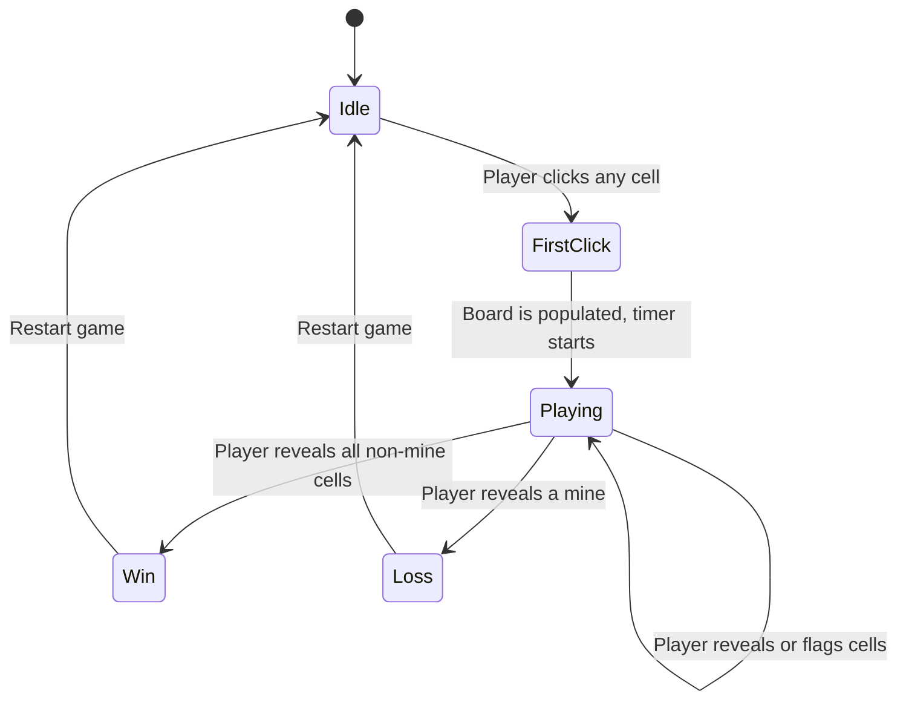

# MineSweeper 💣


Welcome to **MineSweeper**, a classic retro puzzle game implemented in HTML, CSS, and JavaScript. Navigate the minefield without stepping on a hidden bomb!

Play the live version here: [MineSweeper Live](https://johngf.github.io/MineSweeper/)

---

## 🎮 Gameplay Rules & Controls Overview

### Goal
Uncover all the safe cells on the board without clicking on any hidden mines. Use the numbers on the revealed cells to deduce where the mines are!

### Controls
* **Left Click (`🖱️`)**: Reveal a cell. If it's a mine, it's game over!
* **Right Click (`🖱️` Context Menu) or `CTRL`**: Place a flag (🚩) on a cell where you suspect a mine is hidden. Right-click again to change it to a question mark (❓) if you are unsure, and one more time to clear it.
* **Keyboard Navigation**: You can use the `Arrow Keys` to move around the board. Press `Space` to reveal and `Control` to place a flag.

---

## 🔁 Game Loop State Machine



---

## 🚀 Quickstart Commands

To run this game locally on your machine and test out your changes, you can use any basic web server, for instance using Node's `npx` or Python:

### With Node.js/npx
```bash
npx serve .
```

### With Python
```bash
python3 -m http.server
```

Then, open your web browser and navigate to `http://localhost:3000` (or `8000` for Python) to play!

### Running Tests
To run the test suite (requires Node.js):
```bash
npm install
npm test
```

## 📜 License
Under Apache License.
